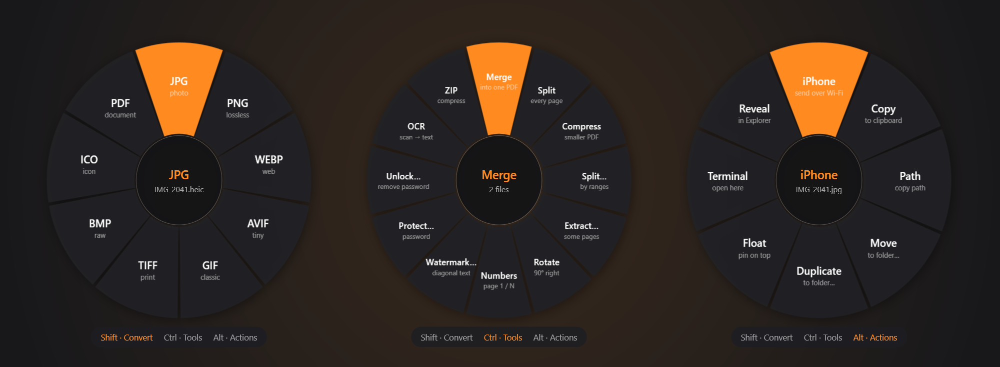
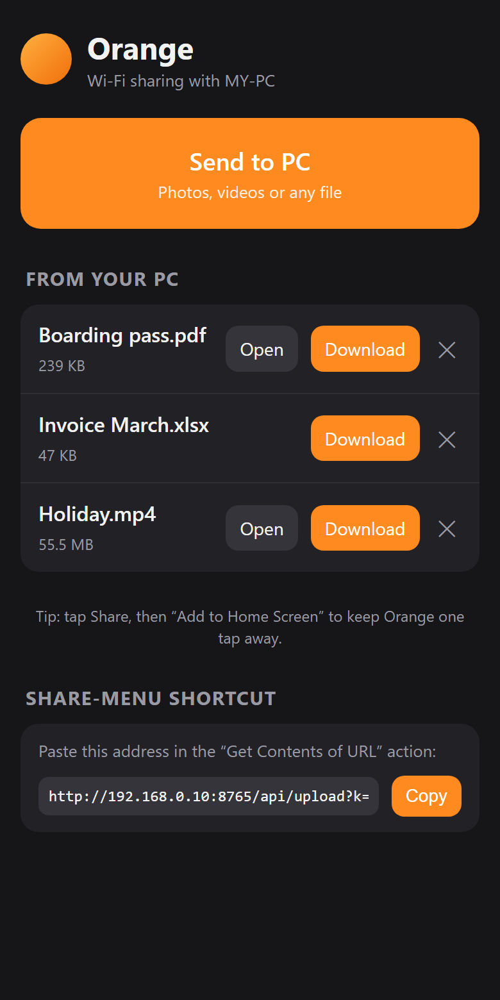
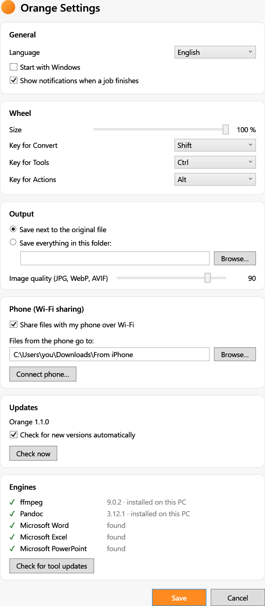

<div align="center">


# Orange

**The zero-click offline file converter for Windows.**

Drag a file, tap Shift, and drop. Everything happens on your PC.

[🇪🇸 Español](README.md) · 🇬🇧 English · [🇧🇷 Português](README.pt.md)

[**⬇️ Download for Windows**](https://github.com/koko00123/orangefile/releases/latest)



</div>

| **60+** | **30+** | **8** | **📱** |
|:---:|:---:|:---:|:---:|
| image, video, audio, PDF, Office formats and more | tools: merge, split, compress, OCR… | quick actions for any file | iPhone ⇄ PC over Wi-Fi, no cables, no WhatsApp |

## Three keys. Three wheels.

Start dragging any file (or several) and tap a key. A wheel appears under your mouse: drop the file on an option and you're done. The result is saved next to the original.

### ⇧ Shift · Convert
Change the format without opening any app. HEIC → JPG, MOV → MP4, DOCX → PDF, XLSX → PDF, PDF → Word, M4A → MP3…

### Ctrl · Tools
What would take five different websites, in one gesture. **Merge and split PDFs**, compress PDFs and videos, extract pages, page numbers, watermark, password, OCR, resize images, remove audio, ZIP…

### Alt · Actions
For any file, folder or mixed selection. **Send to iPhone**, copy, copy path, move, duplicate, float an image on top of everything, open a terminal here.

> No drag? Double-click the tray icon, pick files and click the wheel.

## 📱 Your own AirDrop between iPhone and PC



Scan a QR code with the iPhone camera and Orange becomes an icon on your Home Screen. No app, no account, no cloud.

- **iPhone → PC:** tap *Send to PC* and pick photos, videos or files. They land in a folder on your PC, with a notification.
- **PC → iPhone:** drag a file, tap **Alt** and drop it on *iPhone*. It shows up on your phone, ready to download.
- **Share menu:** with an iOS Shortcut, *Send to Orange* appears when you share from Photos or Files, just like AirDrop.

Files go straight over your Wi-Fi. Only phones that scanned your code can connect.

<br clear="right">

## Formats

| | |
|---|---|
| **Images** | JPG PNG WEBP AVIF HEIC GIF TIFF BMP ICO SVG → PDF |
| **Video** | MP4 MOV MKV WEBM AVI WMV GIF → MP3 M4A WAV |
| **Audio** | MP3 M4A WAV FLAC OGG OPUS AIFF WMA |
| **PDF** | → DOCX PPTX JPG PNG TXT MD EPUB HTML RTF ODT · merge, split, compress, OCR |
| **Documents** | DOCX DOC ODT RTF TXT HTML MD EPUB |
| **Spreadsheets** | XLSX XLS ODS CSV TSV → PDF HTML |
| **Presentations** | PPTX PPT ODP → PDF, one image per slide |
| **Archives** | ZIP RAR 7Z TAR GZ BZ2 XZ: extract and repack |
| **Subtitles** | SRT ⇄ VTT → TXT |

<sub>Word, Excel and PowerPoint conversions use Microsoft Office when installed. RAR and 7Z are extract-only.</sub>

## 🔒 Your files never leave your PC

Online converters upload your documents to someone else's servers. **Orange converts everything on your machine**: contracts, passports and photos are never uploaded.

## Settings



- Language: **English, Spanish or Portuguese**
- Wheel size and the key for each mode
- Save next to the original or always in one folder
- Image quality
- Phone sharing and the folder for received files
- **Automatic Orange updates** and a button to **update ffmpeg and Pandoc**

<br clear="right">

## Install

1. Download **`Orange-Setup.exe`** from [Releases](https://github.com/koko00123/orangefile/releases/latest).
2. Run it. No admin rights needed. .NET, ffmpeg and Pandoc are included.
3. Look for the orange next to the clock. 🍊

Windows 10 (2004) or Windows 11, 64-bit. Orange updates itself when a new version is out.

## 💛 Orange is free. Help it keep growing

If Orange saves you time (or subscriptions to online converters), here's how to support it:

| | For whom | How |
|---|---|---|
| ☕ **A coffee** | A one-off or monthly tip | [ko-fi.com/koko001239021](https://ko-fi.com/koko001239021) |
| 🇧🇷 **Pix** | From Brazil, no fees | Random key: `ef04cb76-4dbd-4e54-a05e-13d5905ede88` |

And for free: ⭐ **star the repo**, share it, and open *issues* with ideas or bugs.

## Development

Requirements: [.NET 8 SDK](https://dotnet.microsoft.com/download) and [Inno Setup 6](https://jrsoftware.org/isinfo.php) (`winget install Microsoft.DotNet.SDK.8 JRSoftware.InnoSetup`).

```powershell
dotnet run --project Orange   # run in development
.\build.ps1                   # → dist\Orange-Setup-<version>.exe
.\build.ps1 -RefreshTools     # fetch the newest ffmpeg and Pandoc
```

Layout: `Orange/Core` (conversion engines), `Orange/Core/Share` (phone server), `Orange/Core/Updates` (updates), `Orange/Input` (drag + key detection), `Orange/UI` (wheel and windows), `installer/` (Inno Setup).

## Third-party software

[Magick.NET](https://github.com/dlemstra/Magick.NET) (Apache 2.0) · [PDFsharp](https://www.pdfsharp.com/) 6.2 (MIT) · [PdfPig](https://github.com/UglyToad/PdfPig) (Apache 2.0) · [SharpCompress](https://github.com/adamhathcock/sharpcompress) (MIT) · [QRCoder](https://github.com/codebude/QRCoder) (MIT). The installer bundles [FFmpeg](https://ffmpeg.org/) ([gyan.dev](https://www.gyan.dev/ffmpeg/builds/) build, GPL) and [Pandoc](https://pandoc.org/) (GPL); their licenses are installed in `tools\licenses`.
