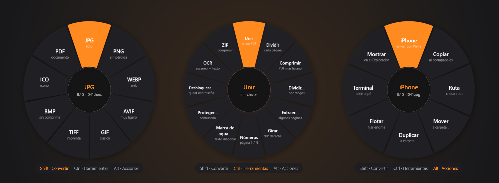
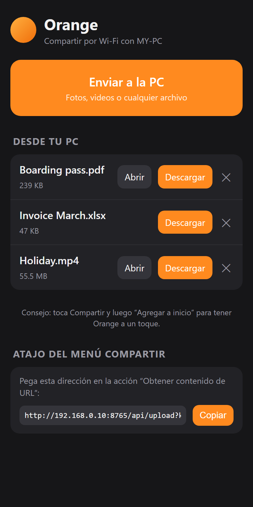
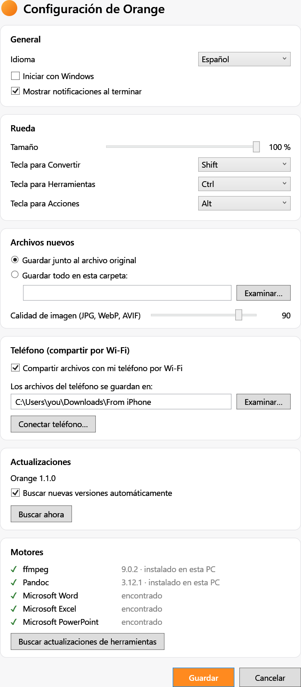

<div align="center">


# Orange

**El conversor de archivos sin clics y sin internet, para Windows.**

Arrastra un archivo, pulsa Shift y suéltalo. Todo pasa en tu PC.

🇪🇸 Español · [🇬🇧 English](README.en.md) · [🇧🇷 Português](README.pt.md)

[**⬇️ Descargar para Windows**](https://github.com/koko00123/orangefile/releases/latest)



</div>

| **+60** | **+30** | **8** | **📱** |
|:---:|:---:|:---:|:---:|
| formatos de imagen, video, audio, PDF, Office y más | herramientas: unir, dividir, comprimir, OCR… | acciones rápidas para cualquier archivo | iPhone ⇄ PC por Wi-Fi, sin cables ni WhatsApp |

## Tres teclas. Tres ruedas.

Empieza a arrastrar cualquier archivo (o varios) y pulsa una tecla. Aparece una rueda bajo el ratón: suelta el archivo en una opción y listo. El resultado se guarda junto al original.

### ⇧ Shift · Convertir
Cambia el formato sin abrir ningún programa. HEIC → JPG, MOV → MP4, DOCX → PDF, XLSX → PDF, PDF → Word, M4A → MP3…

### Ctrl · Herramientas
Lo que harías con cinco webs distintas, en un gesto. **Unir y dividir PDF**, comprimir PDF y videos, extraer páginas, numerar, marca de agua, contraseña, OCR, redimensionar imágenes, quitar audio, ZIP…

### Alt · Acciones
Para cualquier archivo, carpeta o selección mixta. **Enviar al iPhone**, copiar, copiar ruta, mover, duplicar, dejar una imagen flotando encima de todo, abrir la terminal aquí.

> ¿Sin arrastrar? Doble clic en el icono de la bandeja, elige archivos y haz clic en la rueda.

## 📱 Tu propio AirDrop entre iPhone y PC



Escanea un código QR con la cámara del iPhone y Orange queda como un icono en tu pantalla de inicio. Sin app, sin cuenta, sin nube.

- **iPhone → PC:** toca *Enviar a la PC* y elige fotos, videos o archivos. Llegan a una carpeta de tu PC con aviso.
- **PC → iPhone:** arrastra un archivo, pulsa **Alt** y suéltalo en *iPhone*. Aparece en tu teléfono listo para descargar.
- **Menú Compartir:** con un atajo de iOS, *Enviar a Orange* aparece al compartir desde Fotos o Archivos, igual que AirDrop.

Los archivos van directo por tu Wi-Fi. Solo los teléfonos que escanearon tu código pueden conectarse.

<br clear="right">

## Formatos

| | |
|---|---|
| **Imágenes** | JPG PNG WEBP AVIF HEIC GIF TIFF BMP ICO SVG → PDF |
| **Video** | MP4 MOV MKV WEBM AVI WMV GIF → MP3 M4A WAV |
| **Audio** | MP3 M4A WAV FLAC OGG OPUS AIFF WMA |
| **PDF** | → DOCX PPTX JPG PNG TXT MD EPUB HTML RTF ODT · unir, dividir, comprimir, OCR |
| **Documentos** | DOCX DOC ODT RTF TXT HTML MD EPUB |
| **Hojas de cálculo** | XLSX XLS ODS CSV TSV → PDF HTML |
| **Presentaciones** | PPTX PPT ODP → PDF, imágenes por diapositiva |
| **Comprimidos** | ZIP RAR 7Z TAR GZ BZ2 XZ: extraer y recomprimir |
| **Subtítulos** | SRT ⇄ VTT → TXT |

<sub>Word, Excel y PowerPoint usan Microsoft Office si está instalado. RAR y 7Z solo se extraen.</sub>

## 🔒 Tus archivos no salen de tu PC

Los conversores web suben tus documentos a servidores ajenos. **Orange convierte todo en tu equipo**: contratos, pasaportes y fotos nunca se suben a internet.

## Configuración



- Idioma: **español, inglés o portugués**
- Tamaño de la rueda y teclas de cada modo
- Guardar junto al original o en una carpeta fija
- Calidad de imagen
- Compartir con el teléfono y carpeta de recibidos
- **Actualizaciones automáticas** de Orange y botón para **actualizar ffmpeg y Pandoc**

<br clear="right">

## Instalar

1. Descarga **`Orange-Setup.exe`** de [Releases](https://github.com/koko00123/orangefile/releases/latest).
2. Ábrelo. No pide permisos de administrador. Incluye .NET, ffmpeg y Pandoc.
3. Busca la naranja junto al reloj. 🍊

Windows 10 (2004) o Windows 11, 64 bits. Orange se actualiza solo cuando sale una versión nueva.

## 💛 Orange es gratis. Ayúdame a que siga creciendo

Si Orange te ahorra tiempo (o suscripciones a conversores web), estas son las formas de apoyarlo:

| | Para quién | Cómo |
|---|---|---|
| ☕ **Un café** | Una ayuda puntual o mensual | [ko-fi.com/koko001239021](https://ko-fi.com/koko001239021) |
| 🇧🇷 **Pix** | Desde Brasil, sin comisiones | Chave aleatória: `ef04cb76-4dbd-4e54-a05e-13d5905ede88` |

Y gratis: ⭐ **dale una estrella**, compártelo y abre *issues* con ideas o errores.

## Desarrollo

Requisitos: [.NET 8 SDK](https://dotnet.microsoft.com/download) e [Inno Setup 6](https://jrsoftware.org/isinfo.php) (`winget install Microsoft.DotNet.SDK.8 JRSoftware.InnoSetup`).

```powershell
dotnet run --project Orange   # ejecutar en modo desarrollo
.\build.ps1                   # → dist\Orange-Setup-<versión>.exe
.\build.ps1 -RefreshTools     # descargar el ffmpeg y Pandoc más nuevos
```

Estructura: `Orange/Core` (motores de conversión), `Orange/Core/Share` (servidor para el teléfono), `Orange/Core/Updates` (actualizaciones), `Orange/Input` (detección de arrastre + tecla), `Orange/UI` (rueda y ventanas), `installer/` (Inno Setup).

## Software de terceros

[Magick.NET](https://github.com/dlemstra/Magick.NET) (Apache 2.0) · [PDFsharp](https://www.pdfsharp.com/) 6.2 (MIT) · [PdfPig](https://github.com/UglyToad/PdfPig) (Apache 2.0) · [SharpCompress](https://github.com/adamhathcock/sharpcompress) (MIT) · [QRCoder](https://github.com/codebude/QRCoder) (MIT). El instalador incluye [FFmpeg](https://ffmpeg.org/) (build de [gyan.dev](https://www.gyan.dev/ffmpeg/builds/), GPL) y [Pandoc](https://pandoc.org/) (GPL); sus licencias se instalan en `tools\licenses`.
