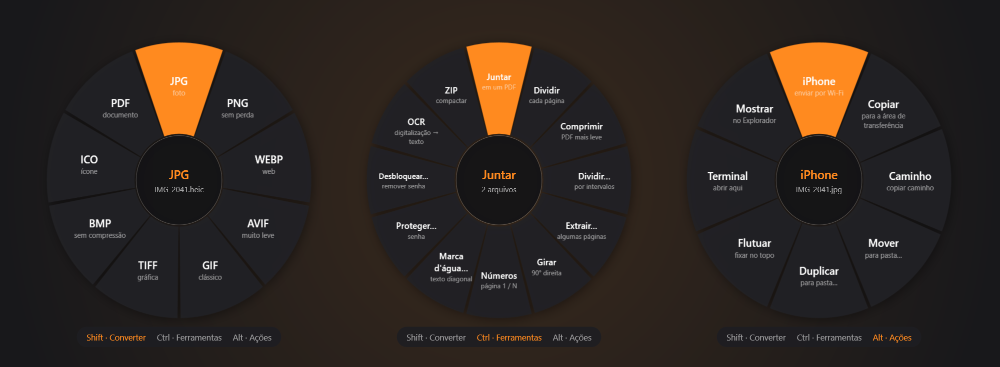
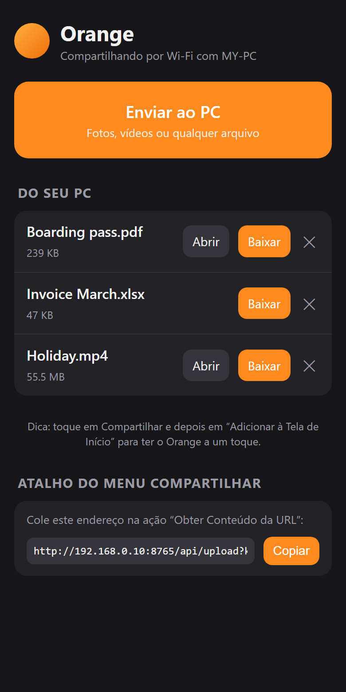
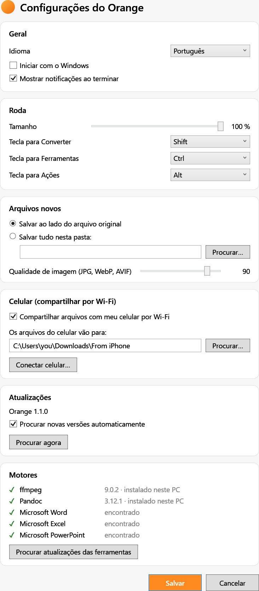

<div align="center">


# Orange

**O conversor de arquivos sem cliques e sem internet, para Windows.**

Arraste um arquivo, toque no Shift e solte. Tudo acontece no seu PC.

[🇪🇸 Español](README.md) · [🇬🇧 English](README.en.md) · 🇧🇷 Português

[**⬇️ Baixar para Windows**](https://github.com/koko00123/orangefile/releases/latest)



</div>

| **+60** | **+30** | **8** | **📱** |
|:---:|:---:|:---:|:---:|
| formatos de imagem, vídeo, áudio, PDF, Office e mais | ferramentas: juntar, dividir, comprimir, OCR… | ações rápidas para qualquer arquivo | iPhone ⇄ PC pelo Wi-Fi, sem cabos nem WhatsApp |

## Três teclas. Três rodas.

Comece a arrastar qualquer arquivo (ou vários) e toque numa tecla. Uma roda aparece embaixo do mouse: solte o arquivo numa opção e pronto. O resultado é salvo ao lado do original.

### ⇧ Shift · Converter
Mude o formato sem abrir nenhum programa. HEIC → JPG, MOV → MP4, DOCX → PDF, XLSX → PDF, PDF → Word, M4A → MP3…

### Ctrl · Ferramentas
O que você faria em cinco sites diferentes, num gesto só. **Juntar e dividir PDF**, comprimir PDF e vídeos, extrair páginas, numerar, marca d'água, senha, OCR, redimensionar imagens, remover áudio, ZIP…

### Alt · Ações
Para qualquer arquivo, pasta ou seleção mista. **Enviar ao iPhone**, copiar, copiar caminho, mover, duplicar, deixar uma imagem flutuando por cima de tudo, abrir o terminal aqui.

> Sem arrastar? Clique duas vezes no ícone da bandeja, escolha arquivos e clique na roda.

## 📱 Seu próprio AirDrop entre iPhone e PC



Escaneie um QR code com a câmera do iPhone e o Orange vira um ícone na sua Tela de Início. Sem app, sem conta, sem nuvem.

- **iPhone → PC:** toque em *Enviar ao PC* e escolha fotos, vídeos ou arquivos. Eles chegam numa pasta do PC, com notificação.
- **PC → iPhone:** arraste um arquivo, toque no **Alt** e solte em *iPhone*. Ele aparece no celular, pronto para baixar.
- **Menu Compartilhar:** com um Atalho do iOS, *Enviar ao Orange* aparece ao compartilhar de Fotos ou Arquivos, igual ao AirDrop.

Os arquivos vão direto pelo seu Wi-Fi. Só os celulares que escanearam o seu código conseguem se conectar.

<br clear="right">

## Formatos

| | |
|---|---|
| **Imagens** | JPG PNG WEBP AVIF HEIC GIF TIFF BMP ICO SVG → PDF |
| **Vídeo** | MP4 MOV MKV WEBM AVI WMV GIF → MP3 M4A WAV |
| **Áudio** | MP3 M4A WAV FLAC OGG OPUS AIFF WMA |
| **PDF** | → DOCX PPTX JPG PNG TXT MD EPUB HTML RTF ODT · juntar, dividir, comprimir, OCR |
| **Documentos** | DOCX DOC ODT RTF TXT HTML MD EPUB |
| **Planilhas** | XLSX XLS ODS CSV TSV → PDF HTML |
| **Apresentações** | PPTX PPT ODP → PDF, uma imagem por slide |
| **Compactados** | ZIP RAR 7Z TAR GZ BZ2 XZ: extrair e recompactar |
| **Legendas** | SRT ⇄ VTT → TXT |

<sub>Word, Excel e PowerPoint usam o Microsoft Office quando instalado. RAR e 7Z só são extraídos.</sub>

## 🔒 Seus arquivos não saem do seu PC

Conversores online enviam seus documentos para servidores de terceiros. **O Orange converte tudo no seu computador**: contratos, passaportes e fotos nunca são enviados para a internet.

## Configurações



- Idioma: **português, inglês ou espanhol**
- Tamanho da roda e a tecla de cada modo
- Salvar ao lado do original ou sempre numa pasta
- Qualidade de imagem
- Compartilhamento com o celular e pasta de recebidos
- **Atualizações automáticas** do Orange e botão para **atualizar ffmpeg e Pandoc**

<br clear="right">

## Instalar

1. Baixe o **`Orange-Setup.exe`** em [Releases](https://github.com/koko00123/orangefile/releases/latest).
2. Abra. Não pede permissão de administrador. Já inclui .NET, ffmpeg e Pandoc.
3. Procure a laranja ao lado do relógio. 🍊

Windows 10 (2004) ou Windows 11, 64 bits. O Orange se atualiza sozinho quando sai uma versão nova.

## 💛 O Orange é grátis. Me ajude a fazê-lo crescer

Se o Orange economiza seu tempo (ou assinaturas de conversores online), estas são as formas de apoiar:

| | Para quem | Como |
|---|---|---|
| ☕ **Um café** | Uma ajuda pontual ou mensal | [ko-fi.com/koko001239021](https://ko-fi.com/koko001239021) |
| 🇧🇷 **Pix** | Do Brasil, sem taxas | Chave aleatória: `ef04cb76-4dbd-4e54-a05e-13d5905ede88` |

E de graça: ⭐ **deixe uma estrela**, compartilhe e abra *issues* com ideias ou erros.

## Desenvolvimento

Requisitos: [.NET 8 SDK](https://dotnet.microsoft.com/download) e [Inno Setup 6](https://jrsoftware.org/isinfo.php) (`winget install Microsoft.DotNet.SDK.8 JRSoftware.InnoSetup`).

```powershell
dotnet run --project Orange   # rodar em modo desenvolvimento
.\build.ps1                   # → dist\Orange-Setup-<versão>.exe
.\build.ps1 -RefreshTools     # baixar o ffmpeg e o Pandoc mais novos
```

Estrutura: `Orange/Core` (motores de conversão), `Orange/Core/Share` (servidor do celular), `Orange/Core/Updates` (atualizações), `Orange/Input` (detecção de arrastar + tecla), `Orange/UI` (roda e janelas), `installer/` (Inno Setup).

## Software de terceiros

[Magick.NET](https://github.com/dlemstra/Magick.NET) (Apache 2.0) · [PDFsharp](https://www.pdfsharp.com/) 6.2 (MIT) · [PdfPig](https://github.com/UglyToad/PdfPig) (Apache 2.0) · [SharpCompress](https://github.com/adamhathcock/sharpcompress) (MIT) · [QRCoder](https://github.com/codebude/QRCoder) (MIT). O instalador inclui o [FFmpeg](https://ffmpeg.org/) (build da [gyan.dev](https://www.gyan.dev/ffmpeg/builds/), GPL) e o [Pandoc](https://pandoc.org/) (GPL); as licenças são instaladas em `tools\licenses`.
